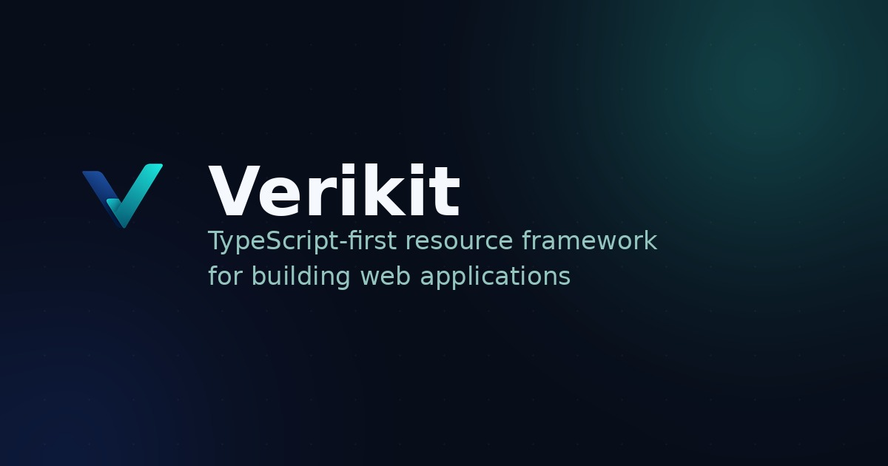

# VeriKit



**Define a resource once, get the rest for free.**

VeriKit is a TypeScript-first resource framework for CRUD-heavy applications.
Define fields, validation, relationships, permissions, and actions in one place,
then use that definition across your API, database adapter, typed client, forms,
and tables.

## Quick start

```sh
npm create verikit@latest my-app
cd my-app
npm run dev
```

You get a working app at http://localhost:3000: React, Hono, Drizzle, and SQLite,
with a sample resource you can search, create, edit, and delete. Add more from the
command line; the database table, migration, API, and admin pages follow:

```sh
npx verikit make:resource Tag name:text color:select:red,green,blue
npm run db:generate
```

## Add to an existing app

```sh
npm install verikit
```

One package, with your framework and ORM installed alongside it (React:
`react react-dom @tanstack/react-query`; Drizzle: `drizzle-orm`). See
[packages/verikit](packages/verikit/README.md) for the full list. The scoped
`@verikit/*` packages are still published for finer-grained installs.

## Example

```ts
import { boolean, defineResource, text } from "verikit";

export const post = defineResource("post", {
  fields: {
    title: text().required(),
    published: boolean().default(false),
  },
});
```

That one definition is what `verikit/server` exposes over REST, `verikit/drizzle` or
`verikit/prisma` backs with a database, `verikit/client` consumes through a typed client, and
`verikit/react` renders as tables and forms. `verikit/react-panel` turns a list of
resources into a full admin panel with navigation and list, create, and edit pages:

```tsx
<Panel title="Acme" resources={[post, user]} />
```

One adapter factory stores every resource, and a `revision` column gives
resources with permissions safe concurrent updates automatically:

```ts
const api = createServer({
  adapter: drizzleAdapter(db, { tables }),
  resources: [{ resource: post, permissions: "open" }],
});
```

## Docs

Guides and API reference: [verikit.dev](https://verikit.dev)

## Status

VeriKit is under active development. APIs may change.

---

Contributing? See [CONTRIBUTING.md](CONTRIBUTING.md) for local setup.